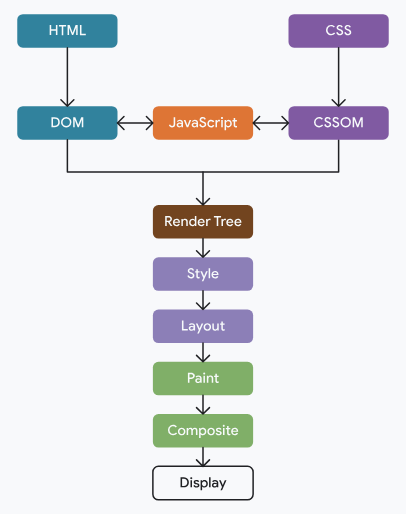

# 渐进式渲染

网页的资源不在本地，浏览器是拿到一部分就先画一部分。原生应用先安装再运行，网页里这两段没有清晰分界。

问题是什么时候开始画：

- **太早**：只有一段 HTML，CSS 和必要的 JS 还没到。页面会先看起来是坏的，等资源到齐再大变一次。不如先留一段空白，等够画出一版像样的页面再显示。
- **太晚**：等所有资源都到了才画。页面其实更早就能用，这段等待是多余的。

浏览器要有一个下限：初始渲染缺了这些资源就会明显难看，所以要等它们。同时也不能等太久。初始渲染之前的这一串步骤，叫关键渲染路径。

优化时不要让无关资源挡住第一次绘制。也不要把初始画面真正依赖的 CSS、JS 从这条路径里拿掉，否则就会画得太早。

# （关键）渲染路径

1. 用 HTML 构建 DOM。
2. 用 CSS 构建 CSSOM。
3. JavaScript 可以改 DOM 或 CSSOM。
4. 用 DOM 和 CSSOM 构建渲染树。
5. 做样式和布局，确定每个元素放在哪里。
6. 在内存里把元素画成像素。
7. 像素有重叠时，把它们合成。
8. 把合成后的像素画到屏幕上。

# 阻塞初始渲染的资源

初始渲染之前，浏览器至少要等到这些资源：

- HTML 的一部分。
- `<head>` 里会阻塞渲染的 CSS。
- `<head>` 里会阻塞渲染的 JavaScript。

CSS 默认会阻塞渲染。无论是 `<style>` 里的内联样式，还是 `<link rel="stylesheet">` 引用的外部样式，浏览器都会等它下载并处理完，才继续把页面画出来。

把 `<link>` 的 `media` 设成当前对不上的值，它就不再挡住渲染，例如 `<link rel="stylesheet" href="..." media="print">`。以前会用这个办法让非关键 CSS 先下载、不挡住第一次绘制。

同步 JavaScript 会挡住 HTML 解析。解析停住，后面的 DOM 就建不下去，初始渲染也跟着往后推。

Lighthouse 的「消除阻塞渲染的资源」和 WebPageTest 的瀑布图可以标出这些资源。看它们是不是出现在首次绘制之前。
