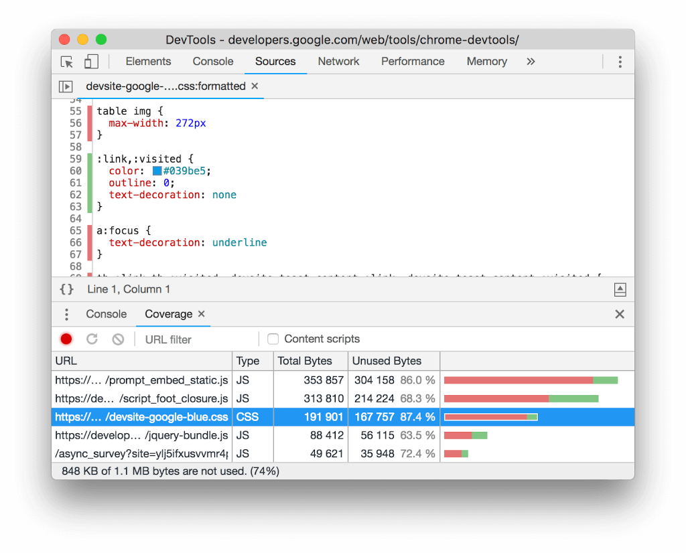
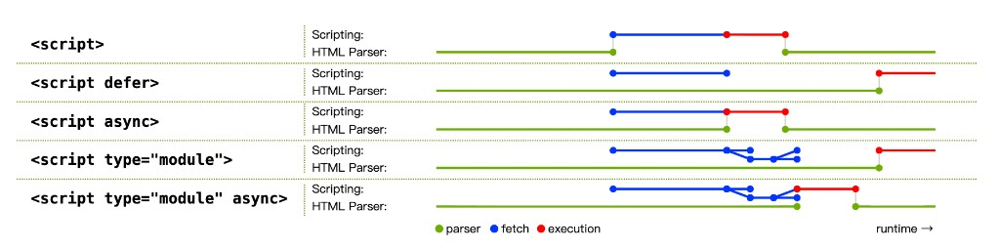

# 阻塞渲染

CSS 会挡住渲染。浏览器要先建好 CSSOM，才开始画页面。

# 阻塞解析器

没有 `async` 或 `defer` 的外部脚本会堵住 HTML 解析器。从发现这个文件，到下载、解析、执行完，解析都停着。

`type="module"` 默认就是 `defer`，不堵住解析。

堵住解析的 `<script>` 还要再等正在传来的、会阻塞渲染的 CSS 下载并解析完，浏览器才执行它。脚本可能用 `element.getComputedStyle()` 去读这些样式表里的样式。

# 预加载扫描器

浏览器在主 HTML 解析器之外再扫一遍原始响应，提前找出资源并开始下载。主解析器被 CSS 或 JavaScript 堵住时，扫描器仍然可以先去下 `` 里的图片。

关键资源要写在服务器返回的 HTML 里，扫描器才看得见。它发现不了这些：

- CSS 里用 `background-image` 引用的图片。
- 用 JavaScript 插进 DOM 的 `<script>`，或 `import()` 动态加载的模块。
- 在客户端用 JavaScript 渲染出来的 HTML。标记藏在脚本字符串里。
- CSS 的 `@import`。

这些资源发现得晚，扫描器帮不上忙。能不用就不用。躲不掉时用 `preload`，避免发现得太晚。

# CSS 优化

1. **缩小体积。** 压缩、去掉注释和重复规则，让下载更快。
2. **删掉没用到的 CSS。** Chrome DevTools 的 Coverage（Sources 面板里，或 Ctrl+Shift+P 搜 Coverage）可以看每个 CSS、JS 有多少字节这次没用到。红色是未使用，绿色是用过的。

3. **避免浏览器去执行的 `@import`。** `<link>` 写在 HTML 里，预加载扫描器能马上发现。`@import` 要等它所在的那份 CSS 下载完才看得见，于是串成请求链，而且扫描器发现不了它。这份 CSS 又会挡住渲染，初始渲染就更晚。

   构建工具（Sass、Less、Vite、webpack）遇到 `@import`，一般是把引用的文件打进同一份样式表，不是各留一个让浏览器再去拉。浏览器拿到的 CSS 里已经没有 `@import`，请求链就不会出现。

   还要担心的是最终文件里仍留着 `@import url(...)`：手写的纯 CSS、第三方样式、用 `@import` 声明 cascade layer。躲不掉时，对那个地址加 `preload`。

# 内联关键 CSS

外链 CSS 多一次下载，会推迟 FCP。把首屏要用的样式内联进 `<head>`，就少这一次请求；浏览器缓存还是空的时候，首次加载更短。其余 CSS 可以异步加载，或放在 `<body>` 末尾。

内联多了，HTML 会变大。HTML 通常不能缓存很久，这段 CSS 也不能像外链那样被后面的页面共用。

# JavaScript

JavaScript 承担大部分交互，但传得太多会让页面在加载时反应慢，互动也会变慢。

## 阻塞渲染

没有 `defer` 或 `async` 的 `<script>`，浏览器会等它下载、解析并执行完，才继续解析和渲染。内联脚本同样会堵住解析器，直到执行完。

## async 与 defer

`async` 和 `defer` 都让外部脚本边下边解析 HTML。`type="module"`（包括内联模块）默认就是延迟执行。

绿线是 HTML 解析，蓝线是下载，红线是执行。

- **`<script>`**：下载和执行都堵住解析器。执行完，解析才继续。
- **`<script defer>`**：下载和解析并行。文档解析完后、`DOMContentLoaded` 之前执行，多个 `defer` 按在标记里的顺序来。
- **`<script async>`**：下载和解析并行，下完就执行，执行时会打断解析器。多个 `async` 不保证顺序。
- **`<script type="module">`**：默认等同 `defer`。依赖的模块会一起下载，文档解析完再按顺序执行。
- **`<script type="module" async>`**：依赖下完就执行，不保证顺序。

用 JavaScript 插进 DOM 的 `<script>`，行为类似 `async`。

## 客户端渲染

关键内容和 LCP 元素不要用 JavaScript 画出来。客户端渲染的标记里，资源预加载扫描器看不见。LCP 图片要等脚本被发现、下载、解析、执行，并把元素插进 DOM 之后才开始下载，串成一条关键请求链。

用脚本改 DOM 也更容易出现长任务。DOM 很大时，互动会更慢。

## 缩小体积

压缩能减小文件，下载更快，浏览器也能更早开始解析和编译。JavaScript 的压缩除了去掉空白和注释，还会缩短变量名、函数名。

